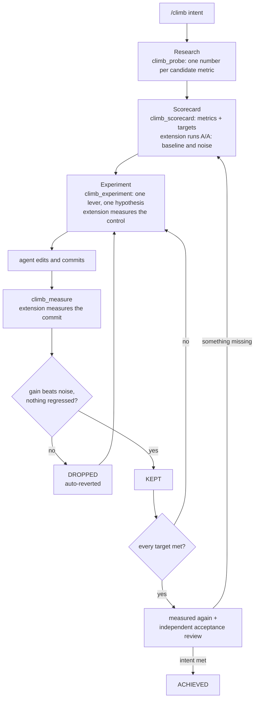
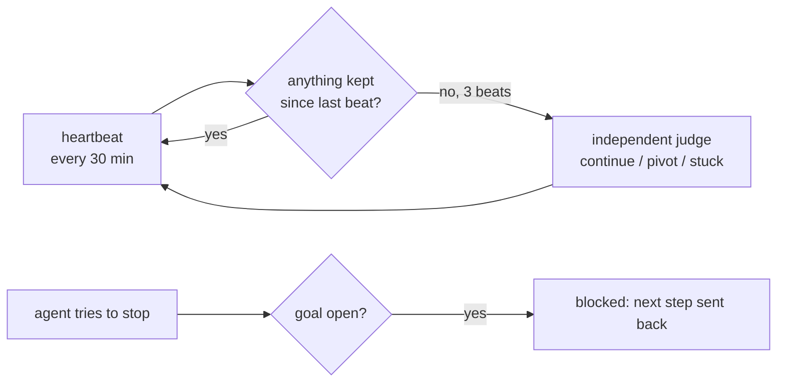

# pi-goal — `/climb`

Autonomous hill-climbing for [omp](https://github.com/can1357/oh-my-pi) and pi. You say what should get better. The agent picks metrics and targets, then keeps trying changes until the targets are met.

The agent writes the code. The extension measures, decides and keeps the record, so the agent cannot grade its own work or quit early.

## Install

```bash
omp plugin install git+ssh://git@github.com/kubet/pi-goal.git
```

Needs a git repo with at least one commit, and a checkout with no other uncommitted work. If the checkout is shared, give the climb its own worktree: `git worktree add ../climb HEAD`, then `/climb move ../climb`.

## Use

```
/climb make the API p50 under 50ms   start a goal (optional: --beat 30m --poke-max 3)
/climb                               progress report
/climb pause | resume                stop / restart the loop
/climb done [goal]                   close a goal
/climb panel                         write .climb/panel.html
/climb move <path>                   carry the climb to another checkout
```

After a restart, `omp -c` picks the climb up from its ledger.

## What happens



Alongside the loop:



## Rules the extension enforces

- **It measures, on commits.** The agent never reports its own numbers. A run that crashes decides nothing.
- **Noise is measured, not guessed.** A gain must beat it. Borderline or drifting metrics are re-run interleaved with the base commit (A B B A), so machine drift cancels out.
- **Drops revert themselves.** An experiment that touches the benchmark is dropped.
- **Holds guard.** A `hold: true` metric ("no slower") has no target; a real regression drops the experiment.
- **Proofs.** An experiment can carry a check that fails before the change and passes after; that keeps a fix the metrics are too coarse to see.
- **Focus.** One open experiment, at most 3 metrics per goal. Three drops in a row call the judge.
- **Big goals split.** `climb_split` makes 2-4 parts, each with its own scorecard. `climb_learn` records facts, traps and dead ends that survive restarts.
- **Achieved means checked.** Targets met twice, then an independent review of the intent. If no review could run, the goal is marked unreviewed.

## Files

Everything lives in `.climb/` (excluded from git):

| File | What |
|---|---|
| `oracle.jsonl` | every decision, append-only |
| `trace.jsonl` | every run and tool call, with timing and refusals |
| `panel.html` | goal tree, metrics vs targets, experiments |
| `export.json` | evidence rows (benchmaxx schema `climb.export/1`) |

Set `CLIMB_SINK=<https url or shell command>` to stream each decision out. Other extensions can listen with `pi.events.on("climb", …)`.

## Develop

```bash
bun test
```
